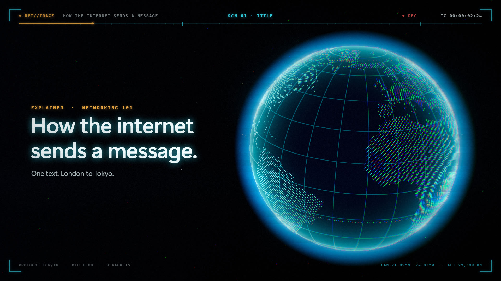
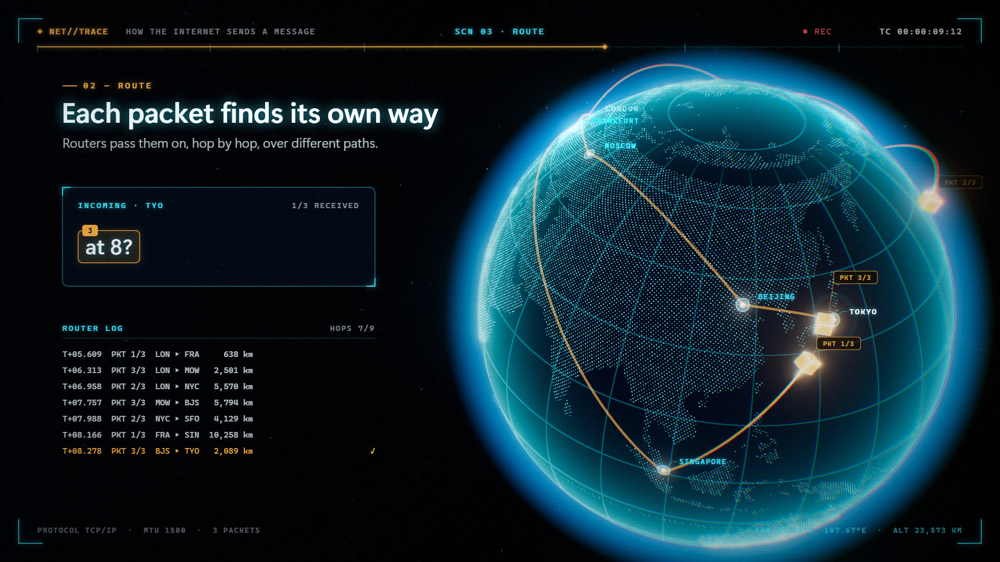

# How the internet sends a message — holographic 3D explainer

A 15-second holographic 3D explainer, "How the internet sends a message", built with Three.js and
rendered deterministically frame by frame to 1080p60 MP4 with Playwright + ffmpeg. Made with Claude Code.




A message from London to Tokyo is split into three numbered packets. Each one takes a different real
route (via Frankfurt and Singapore, New York and San Francisco, or Moscow and Beijing), they arrive out of
order, and Tokyo puts them back together.

1920×1080 @ 60 fps, 900 frames. Every element is a pure function of a time value `t`, so the output is
the same on every render.

## Scripts

```bash
npm install
npm run setup:browser          # once: installs Playwright's Chromium (skip if already installed)
npm run dev                    # preview: slider, Play/Pause (Space), ←/→ = 1 frame, Shift = 30 frames
npm run still                  # one or more stills per scene -> out/stills/
npm run still -- 1.5,8,12.6    # stills at the given seconds
npm run render                 # -> out/internet-explainer.mp4
```

Render options: `--out <file>`, `--crf <n>` (16), `--preset <x264 preset>` (slow), `--workers <n>` (2 pages
in parallel), `--start/--end <frame>` for partial renders, `--keep-frames` to keep the PNG sequence,
`--gl swiftshader` for machines without a usable GPU (much slower).

ffmpeg comes from `ffmpeg-static`, so nothing has to be installed system-wide.

## How it works

`scripts/render.js` starts Vite, opens `?mode=render` in headless Chromium, and for each frame calls
`window.seekTo(t)` followed by `window.captureFrame()` (canvas → PNG). The frames go into a temporary
directory, and ffmpeg encodes them (`libx264`, `yuv420p`, BT.709 tags, `+faststart`). The temporary directory
is deleted afterwards.

| File | Responsibility |
| --- | --- |
| `src/timeline.js` | Master clock: scenes, per-channel camera keys (lat / lon / distance / look-at shift), packet schedule (hop time ∝ arc length → out-of-order arrival), router log, narrative |
| `src/globe.js` | Land mask from `world-atlas/land-110m` + `topojson-client`, ~30k Fibonacci-sphere dots (round, far-side fade, longitude sweep), ocean (fresnel rim + 15° grid via `fract`/`fwidth`), additive atmosphere shell, star field |
| `src/routes.js` | City coordinates, slerp great-circle arcs lifted by distance, `TubeGeometry` trails with a draw-on shader and bright head, surface-aligned router rings with pulses, packet cubes |
| `src/hud.js` | 2D canvas drawn every frame: corner brackets, mono top rail and timecode, glowing headlines, outgoing/incoming cards, router log, pinned city labels and packet tags (hidden behind the globe) |
| `src/postprocessing.js` | Half-float 4× MSAA target → UnrealBloom → ACES (OutputPass) → final pass: chromatic aberration, HUD composite, scan lines, rolling band, grain, vignette |
| `src/main.js` | Wiring, `window.seekTo` / `window.captureFrame`, preview UI |

Fonts: SF Pro / SF Mono where installed, otherwise Segoe UI / Cascadia / Consolas.
